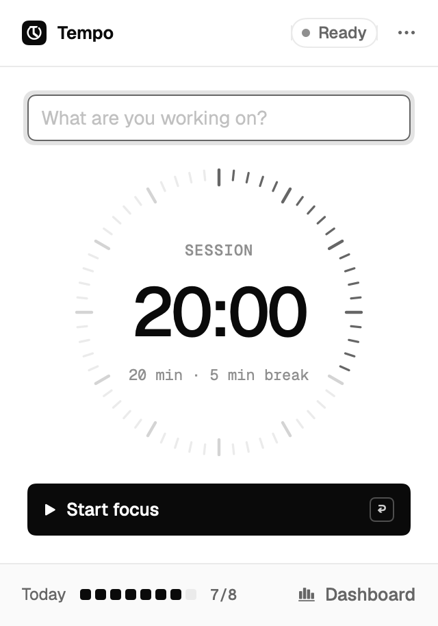
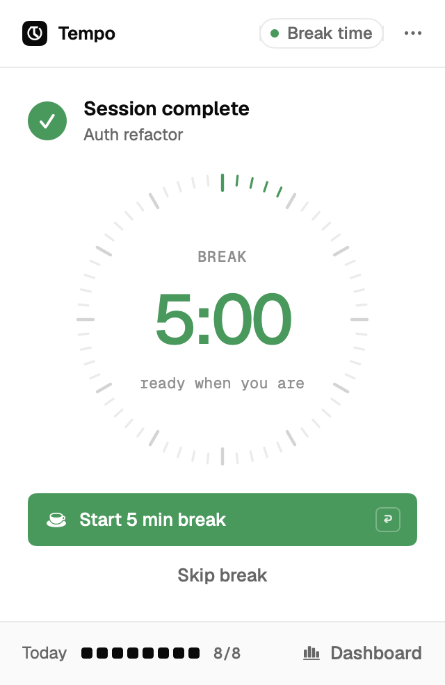
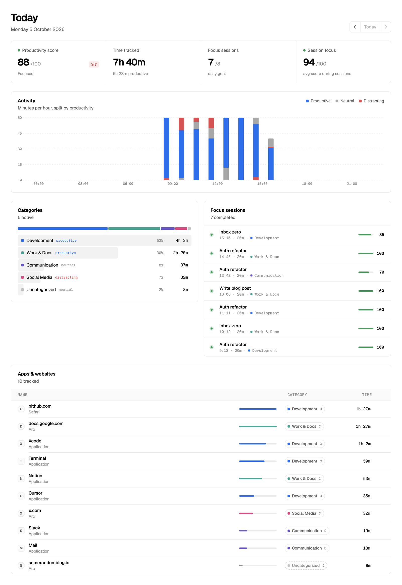
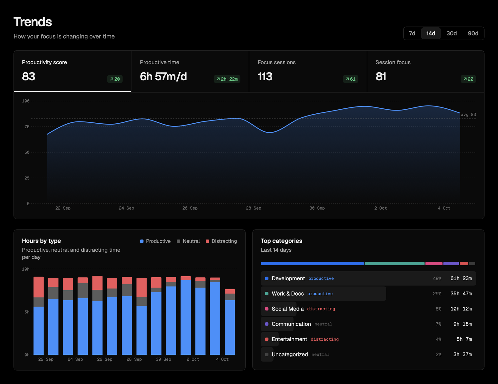
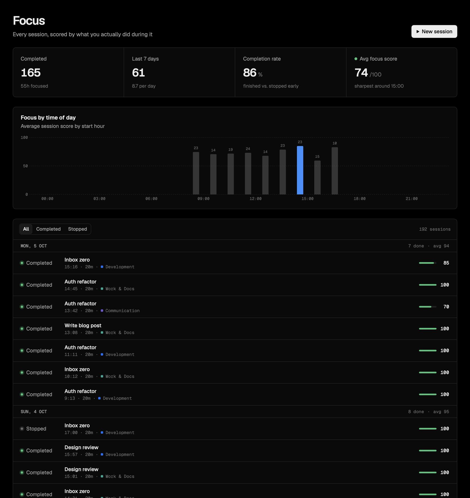

# Tempo

**A private, open-source time tracker and focus timer that lives in your Mac's menu bar.**

Tempo automatically records which app (and which website) you're using, sorts it into categories you control, and gives you a productivity score. It's paired with a built-in focus timer (pomodoro) that scores every session by what you *actually* did during it. Everything stays on your Mac as plain JSON files, with no account, no cloud and no telemetry.

<p align="center">
  
  &nbsp;&nbsp;
  
</p>



> **Setting this up with an AI assistant?** Point it at [`AGENTS.md`](AGENTS.md). It contains exact, verifiable setup steps.

---

## Why Tempo? (A free alternative to Timing)

[Timing](https://timingapp.com) is an excellent commercial automatic time tracker for macOS. Tempo was built as a personal replacement for its core loop, which is to *see where your time goes, categorise it and track how productive you are*, plus a focus timer built into the same app.

| | **Tempo** |
|---|---|
| Automatic app + website tracking | ✅ Frontmost app every 5s, plus the active tab's domain in Safari, Chrome, Arc, Dia, Brave, Edge, Vivaldi and Opera |
| Categories and rules | ✅ Rules for apps or domains (a domain covers its subdomains), applied retroactively to all history |
| Productivity score | ✅ 0–100 from productive / neutral / distracting time |
| Focus timer | ✅ Built in. Each session gets its own focus score; goal tracking; best hours of the day |
| Trends | ✅ 7 / 14 / 30 / 90 days, compared with the previous period |
| Idle detection | ✅ Stops counting after N minutes without input, on sleep and on screen lock |
| Never-track list | ✅ Delete an app or site's history and never record it again |
| Data | 📁 Local JSON in `~/Library/Application Support/Tempo/`. No network access at all |
| Cost | Free, MIT licensed, and the code is yours to hack on |

**What Timing has that Tempo doesn't (yet):** projects and billable time entries, reports and exports, document/window-title level tracking, sync across Macs and team features. If you rely on those, stick with Timing. If you mostly want "where did my day go, and how focused was I?", Tempo covers it.

There's no importer for Timing data. Recreate the categories you care about in Tempo; the defaults already cover the common ones (Development, Work & Docs, Communication, Social Media, Entertainment, Shopping, Utilities).

---

## Features

**Menu bar focus timer**
- Click the icon, type what you're working on, press <kbd>Return</kbd>. A 60-tick minute dial counts down (one tick per minute).
- The menu bar shows the time left (`18:32`) while you focus.
- When a session ends, the menu bar shows **✓ Done** until you look. The popover then offers a green **5-minute break**, which you start yourself (or skip). When the break ends, it shows **Ready**.
- Today's progress against your daily goal is always visible. Running sessions survive restarts and updates.

**Dashboard** (click *Dashboard* in the popover, or press <kbd>⌘D</kbd>)
- **Overview:** score, time tracked, focus sessions, hourly activity, category breakdown, and every app and site with one-click categorisation.
- **Trends:** score, productive time, sessions and session focus over time, versus the previous period.
- **Focus:** every session with its focus score, completion rate and your best hours of the day.
- **Categories:** create categories, set productive / neutral / distracting, manage rules, sort uncategorised items, and view the never-track list.
- **Settings:** focus and break length, daily goal, idle threshold, website tracking and launch at login.

<p align="center"></p>
<p align="center"></p>

---

## Requirements

- macOS **14 Sonoma** or later (Apple Silicon or Intel)
- **Xcode 15+** (or the Xcode Command Line Tools with Swift 5.9+). Running the tests requires full Xcode.

## Install

```bash
git clone https://github.com/alexjackhughes/tempo.git
cd tempo
./scripts/build-app.sh --install
```

This compiles a release build, packages `Tempo.app`, copies it to `/Applications` and launches it. Look for the Tempo icon in your menu bar.

**On first run, macOS will ask for:**
1. **Notifications:** allow, so you're told when a session or break ends.
2. **Browser access ("Tempo wants to control Safari/Chrome/…")**, which appears the first time you use each browser. Allow it so Tempo can read the current tab's **domain** (it never stores full URLs). If you deny it, that browser is tracked as an app only.

**Optional:** turn on **Launch at login** in Dashboard → Settings so tracking starts automatically.

### Updating

```bash
cd tempo && git pull && ./scripts/build-app.sh --install
```

Your data, settings and any running session are kept.

### Uninstall

In the popover, open the `…` menu → **Quit Tempo**, then:

```bash
rm -rf /Applications/Tempo.app
rm -rf ~/Library/Application\ Support/Tempo   # deletes all your tracked data
```

---

## How it works

- **Tracking:** every 5 seconds (and on every app switch) Tempo records the frontmost app. For supported browsers it asks the browser for the active tab's URL via AppleScript and keeps only the domain (`www.` stripped). Consecutive samples merge into segments.
- **Idle:** if there's no keyboard or mouse input for the idle threshold (default 3 minutes), the segment is trimmed back to when you went idle. Sleep and screen lock also stop tracking. A handful of system surfaces (Dock, notification prompts, the login window) are never recorded.
- **Categories:** rules map an **app** (name or bundle ID) or a **domain** to a category. The most specific domain wins (`mail.google.com` beats `google.com`). Rules are evaluated when data is read, never when it's written, so changing a rule instantly re-categorises all of your history.
  - Assigning a site from the dashboard covers its **whole domain** by default (`app.hubspot.com` → all of `hubspot.com`), except shared domains like `google.com`, where each subdomain is a different product. Use *Only <host>* in the menu for exact matches.
- **Score:** `productive × 1 + neutral × 0.5 + distracting × 0`, as a percentage of tracked time. Uncategorised time counts as neutral.
- **Focus sessions:** a session's score is the same calculation over just that session's time window, which is how Tempo can tell a focused 20 minutes from 20 minutes on YouTube.
- **Never track:** hovering over an app or site and clicking the bin icon permanently deletes its recorded time from every day and adds it to a never-record list. You can resume tracking from Categories, but deleted time can't be restored.
- **Quitting:** Tempo is meant to always run. <kbd>⌘Q</kbd> or *Quit* from the Dock only closes the dashboard; tracking continues. To really quit, use **`…` → Quit Tempo** in the popover. Logout and shutdown quit normally.

## Your data

Everything lives in `~/Library/Application Support/Tempo/`:

| File | Contents |
|---|---|
| `activity/YYYY-MM-DD.json` | One file per day: `[{start, end, app, bundleID, domain?}]` (Unix timestamps) |
| `sessions.json` | Focus sessions: start, end, task, planned minutes, completed |
| `config.json` | Categories, rules, never-track list and settings |
| `active-session.json` | The currently running timer, if any |

Tempo makes **no network requests**. Back up, sync or delete that folder however you like.

## Troubleshooting

| Problem | Fix |
|---|---|
| Menu bar icon is missing | On MacBooks with a notch, macOS hides menu bar icons that don't fit. Hold <kbd>⌘</kbd> and drag Tempo's icon further right, or quit a few menu bar apps. Launching Tempo again from Spotlight opens the dashboard either way. |
| Websites show only as "Chrome"/"Safari" | Browser access was denied. Dashboard → Settings → *Open Automation settings* and enable Tempo for that browser. Firefox doesn't support this at all. |
| Browser permission prompts appear again after rebuilding | The build is ad-hoc signed, so macOS treats each rebuild as a new app. Approve again, or reset with `tccutil reset AppleEvents com.alexhughes.tempo`. |
| Time stops counting while watching videos | That's idle detection. Raise *Idle detection* in Settings. |
| No notifications | System Settings → Notifications → Tempo → allow. |

## Development

```bash
swift build                 # debug build
swift test                  # unit tests (requires Xcode)
TEMPO_SNAPSHOT_DIR=/tmp/shots swift test --filter SnapshotTests   # render every screen to PNGs with sample data
./scripts/build-app.sh      # package build/Tempo.app without installing
TEMPO_BUNDLE_ID=com.yourname.tempo ./scripts/build-app.sh --install   # use your own bundle ID
```

It's a Swift Package (no Xcode project) using SwiftUI, Swift Charts and Observation.

```
Sources/Tempo/
  TempoApp.swift         App entry, menu bar + dashboard scenes, quit/SIGTERM handling
  ActivityTracker.swift  Sampling, idle/sleep/lock detection, browser domain via AppleScript
  Store.swift            JSON persistence, recording/merging segments, queries, rules, never-track
  Analytics.swift        Categorizer (rule matching), summaries, scores, hourly/day stats
  Models.swift           Segments, categories, rules, sessions, config + default rules
  Pomodoro.swift         Focus → break-ready → break state machine, persistence, notifications
  Views/                 Menu bar popover, dashboard pages, design system (Theme.swift), logo glyph
Tests/TempoTests/        Logic tests + snapshot renderer
scripts/build-app.sh     Builds, signs (ad hoc) and installs the .app
```

## Credits and licence

- Code: [MIT](LICENSE)
- Fonts: [Geist Sans and Geist Mono](https://github.com/vercel/geist-font) under the SIL Open Font License (`Resources/Fonts/OFL.txt`)
